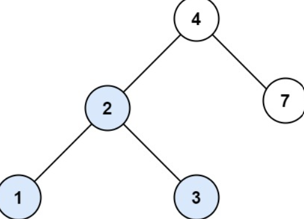

# Problem Statement

[Leetcode - Search in a Binary Search Tree](https://leetcode.com/problems/search-in-a-binary-search-tree/description/?envType=study-plan-v2&envId=leetcode-75)

You are given the **root** of a binary search tree (BST) and an **integer** val.

Find the **node** in the BST that the node's _value_ equals val and return the subtree rooted with that node. If such a node does not exist, return null.

## Examples



**Input**: root = [4,2,7,1,3], val = 2
**Output**: [2,1,3]

## Observations

BST holds values in sorted orded where the values smaller than the root lie on the left sub-tree and values greater then the root lie on the right subtree. Using this we can run a recursive approach which check the two conditions and the equality one to find the target value.

## Algorithm

1. Check root if it is not null, if so return None
2. check if root.val == val, if so return the node (as we have to return the subtree, not the value)
3. If root.val is <, proceed towards the right
4. If root.val >, proceed towards the left.

## Complexity

- **Time**: _O(N)_
- **Space**: _O(N)_

## Code

```python

# Definition for a binary tree node.
# class TreeNode:
#     def __init__(self, val=0, left=None, right=None):
#         self.val = val
#         self.left = left
#         self.right = right
class Solution:
    def searchBST(self, root: TreeNode | None, val: int) -> TreeNode | None:
        if not root:
            return None

        if root.val == val:
            return root
        if root.val > val:
            return self.searchBST(root.left, val)
        if root.val < val:
            return self.searchBST(root.right, val)

```

## Mistakes / Gotchas

1. Forgetting return before calling the function recursively
2. Doing root is None instead of **not** root.
