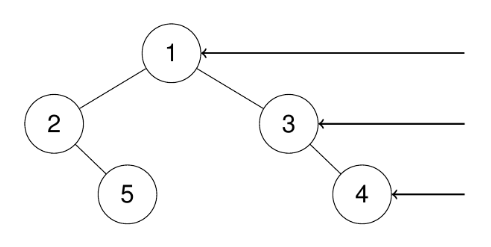

# Problem Statement

[Leetcode - Binary Tree Right side view](https://leetcode.com/problems/binary-tree-right-side-view/description/?envType=study-plan-v2&envId=leetcode-75)

Given the **root** of a binary tree, imagine yourself standing on the **right** side of it, return the values of the nodes you can see ordered from top to bottom.

## Examples

**Input**: root = [1,2,3,null,5,null,4]
**Output**: [1,3,4]



## Observations

To check the right side, we are effectively expanding the search space, thus it is a BFS algorithm. We can go level by level and append the right-most node's value. The right most node will be the last node of each level

## Algorithm

1. Set q = [root]
2. Set ans = []
3. Loop over the queue until it becomes empty
4. Obtain the size of the queue before iterating over the levels
5. For each level, grab the node and check if we are at the end of the level, if so, then append node.val into answer
6. Check if node's left or right child exist.
7. If they do add them to the queue
8. Return answer at the end

## Complexity

- **Time**: _O(N)_
- **Space**: _O(N)_

## Code

```python

# Definition for a binary tree node.
# class TreeNode:
#     def __init__(self, val=0, left=None, right=None):
#         self.val = val
#         self.left = left
#         self.right = right
from collections import deque
class Solution:
    def rightSideView(self, root: TreeNode | None) -> list[int]:
        if not root:
            return []

        ans = []
        q = deque([root])

        while q:
            size = len(q)
            for i in range(size):
                node = q.popleft()
                if i == size-1:
                    ans.append(node.val)
                if node.left:
                    q.append(node.left)
                if node.right:
                    q.append(node.right)

        return ans

```

## Mistakes / Gotchas

1. Appending the node.val into the queue instead of the answer.
2. Not checking left and right child of the current node, causing unexpected behaviour.
