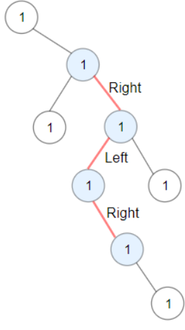

# Problem Statement

[Leetcode - Maximum ZigZag Path of a Binary tree](https://leetcode.com/problems/longest-zigzag-path-in-a-binary-tree/description/?envType=study-plan-v2&envId=leetcode-75)

You are given the **root** of a binary tree.

A _ZigZag_ path for a binary tree is defined as follow:

Choose any node in the binary tree and a direction (right or left).

- If the current direction is right, move to the right child of the current node; otherwise, move to the left child.
- Change the direction from right to left or from left to right.
- Repeat the second and third steps until you can't move in the tree.
- Zigzag length is defined as the number of nodes visited - 1. (A single node has a length of 0).

Return the **longest ZigZag** path contained in that tree.

## Examples



**Input**: root = [1,null,1,1,1,null,null,1,1,null,1,null,null,null,1]
**Output**: 3

## Observations

To solve this Qs, we need to keep track of two things:

- The direction which we want to start from and proceed to
- The length at each step.

The direction problem is solved using the boolean flags or by using a literal 'L' or 'R'. The length problem is solved by tracking length at each stage and before entering the next subtree or level, we set a global variable to the max of (global_var, length)

## Algorithm

1. Define DFS with node, direction and length
2. check it node is null, if it return (standard base case)
3. Update the global var with max of (global_var, length).
4. If we are going to the right, proceed that way (node.right), but set the direction for the next step to left. Also increment the length.
5. Then alternate from right to left through node.left and direction to right being set for next step and length being reset to 1.
6. If we are going to the left, proceed that way (node.left), but set the direction for the next step to right. Also increment the length.
7. Then alternate from left to right through node.right and direction to left being set for next step and length being reset to 1.
8. Call DFS inside the driver and return the global variable.

## Complexity

- **Time**: _O(N)_
- **Space**: _O(N)_

## Code

```python

# Definition for a binary tree node.
# class TreeNode:
#     def __init__(self, val=0, left=None, right=None):
#         self.val = val
#         self.left = left
#         self.right = right
class Solution:
    def longestZigZag(self, root: TreeNode | None) -> int:
        self.visited = 0

        def dfs(node, isRight, length):
            if not node:
                return
            self.visited = max(self.visited, length)

            if isRight:
                dfs(node.right, False, length + 1)
                dfs(node.left, True, 1)
            else:
                dfs(node.left, True, length + 1)
                dfs(node.right, False, 1)

        dfs(root, True, 0)
        return self.visited

```

## Mistakes / Gotchas

1. Messing up the direction flags when moving to the right
2. Not updating the global variable.
