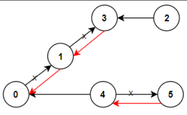

# Problem Statement

[LeetCode - Reorder Routes to Make All Paths Lead to the City Zero](https://leetcode.com/problems/reorder-routes-to-make-all-paths-lead-to-the-city-zero/description/?envType=study-plan-v2&envId=leetcode-75)

There are n cities numbered from 0 to n - 1 and n - 1 roads such that there is only one way to travel between two different cities (this network form a tree). Last year, The ministry of transport decided to orient the roads in one direction because they are too narrow.

Roads are represented by connections where **_connections[i] = [ai, bi]_** represents a road from city ai to city bi.

This year, there will be a big event in the capital (city 0), and many people want to travel to this city.

Your task consists of reorienting some roads such that each city can visit the city 0. Return the minimum number of edges changed.

It's **guaranteed** that each city can reach city 0 after reorder.

## Examples



**Input**: n = 6, connections = [[0,1],[1,3],[2,3],[4,0],[4,5]]
**Output**: 3
**Explanation**: Change the direction of edges show in red such that each node can reach the node 0 (capital).

## Observations

After evaluating the example we can arrive at a conclusion that an edge from Parent to Child is wrong and needs flipping. To do this we need an adjacency list, where parent to child connections will have a cost 1 and child to parent have cost 0.

## Algorithm

1. Init adj list and flip count
2. Construct the list
3. Run dfs from city 0 and for every unvisited city, add the cost to flip
4. return flips

## Complexity

- **Time**: _O(N)_
- **Space**: _O(1)_

## Code

```python

class Solution:
    def minReorder(self, n: int, connections: list[list[int]]) -> int:

        self.adj = [[] for _ in range(n)]
        self.flips = 0

        for a, b in connections:
            self.adj[a].append((b, 1))
            self.adj[b].append((a, 0))

        def dfs(start, v):
            v.add(start)
            for neighbour, cost in self.adj[start]:
                if neighbour not in v:
                    self.flips += cost
                    dfs(neighbour, v)

        dfs(0, set())
        return self.flips

```

## Mistakes / Gotchas

1. Not appending a nd b properly in the adj list
2. not running dfs again on a neighbour.
3. Not returning flips
